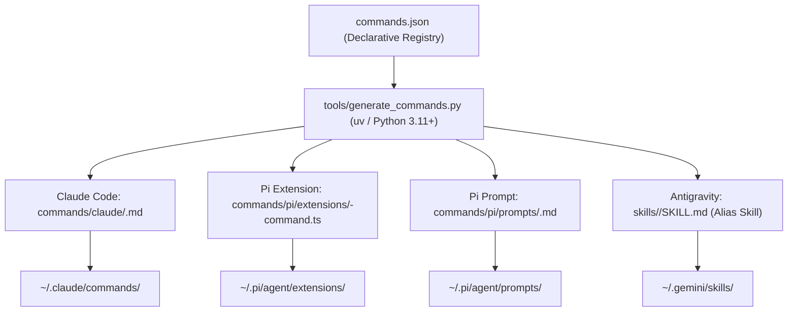

# Slash Commands Registry & Multi-Agent Compilation

This document specifies the architecture and workflow for managing declarative slash commands across multiple AI agent runtimes: **Claude Code**, **Pi**, and **Antigravity / Gemini CLI**.

---

## Overview

While different agent runtimes implement slash commands with varying mechanisms, this repository unifies their definition into a single declarative registry: [`commands.json`](../../commands.json).

A Python compiler tool ([`tools/generate_commands.py`](../../tools/generate_commands.py)) compiles this registry into runtime-native artifacts, validated by unit tests and managed via the root [`Makefile`](../../Makefile).



---

## Registry Schema: `commands.json`

The registry is validated by the JSON Schema at [`tools/commands.schema.json`](../../tools/commands.schema.json).

```json
{
  "$schema": "./tools/commands.schema.json",
  "commands": [
    {
      "name": "adr",
      "skill": "architecture-decision-records",
      "title": "Architecture Decision Records",
      "description": "Create, update, or review an Architecture Decision Record (ADR)",
      "default_action": "creating or reviewing an Architecture Decision Record",
      "instructions": [
        "Enforce the 5 Core Tenets: Intent over Mechanism, Reification over Tribal Memory...",
        "Structure the record using the 8-row Tabular Y-Statement and prioritized Decision Drivers..."
      ]
    }
  ]
}
```

### Fields

| Field | Type | Required | Description |
|---|---|---|---|
| `name` | string | **Yes** | Command slug matching `^[a-z0-9-]+$` (e.g. `adr`, `review`, `c4`). |
| `skill` | string | **Yes** | Backing skill folder name in `skills/` (must contain `SKILL.md`). |
| `description` | string | **Yes** | Concise description displayed in agent command autocomplete menus. |
| `title` | string | No | Display title used in documentation and Pi notification toasts. |
| `default_action` | string | No | Fallback prompt phrase when the command is invoked without arguments. |
| `alias_skill` | boolean | No | Whether to generate an Antigravity alias skill in `skills/<name>/SKILL.md` (default: `true` if `name != skill`). |
| `instructions` | array / string | No | Core tenets or guidelines embedded in the prompt and alias skill. |
| `prompt_template` | string | No | Optional custom Claude Code prompt template containing `$ARGUMENTS`. |

---

## Active Registered Commands (15 total)

| Command | Backing Skill | Category | Description |
|---|---|---|---|
| **`/adr`** | `architecture-decision-records` | Architecture | Create, update, or review an Architecture Decision Record (ADR) |
| **`/review`** | `bart-adversarial-reviewer` | Quality | Bart adversarial code and pull request reviewer |
| **`/humanize`** | `ai-text-humanizer` | Quality | Strip AI writing tells, filler, and formulaic patterns |
| **`/c4`** | `c4-architecture` | Architecture | Generate C4 model Mermaid architecture diagrams |
| **`/commit`** | `git-commit-formatter` | Quality | Atomic Commit Protocol (ACP) & Conventional Commits |
| **`/standup`** | `daily-standup` | Planning | Process meeting transcripts into daily execution plans |
| **`/status`** | `daily-status` | Planning | Generate factual activity recall from git and issue trackers |
| **`/bdd`** | `adzic-bdd` | Testing | Specification by Example & Adzic Index for Gherkin |
| **`/debug`** | `systematic-debugging` | Diagnostics | Root cause debugging before proposing fixes |
| **`/test-review`** | `test-design-review` | Testing | Critique tests against Farley & Adzic dual rubrics |
| **`/doctor`** | `branch-doctor` | Diagnostics | Branch health: git history, local tests, CI, and PR well-formedness |
| **`/forensics`** | `git-forensics` | Codebase | Churn, bug hotspots, bus factor, and pickaxe archaeology |
| **`/codemap`** | `codemap` | Codebase | Architectural file graph, dependency flow, and hub files |
| **`/trace`** | `macro-to-micro` | Codebase | Multi-tier code tracing (Codemap $\rightarrow$ LSP $\rightarrow$ AST-grep) |
| **`/lessons`** | `lessons-learned` | Retrospective | Extract engineering principles and anti-patterns from git diffs |

---

## Target Runtime Artifacts

### 1. Claude Code
- **Path:** `commands/claude/<name>.md`
- **Deployment:** Symlinked to `~/.claude/commands/<name>.md`
- **Mechanism:** Claude Code treats files in `~/.claude/commands/` as custom slash commands. Arguments typed by the user after `/cmd` are injected into `$ARGUMENTS`.

### 2. Pi Coding Agent
- **Path (Extension):** `commands/pi/extensions/<name>-command.ts`
  - **Deployment:** Symlinked to `~/.pi/agent/extensions/<name>-command.ts`
  - **Mechanism:** Registers `/<name>` via `pi.registerCommand()` with follow-up queueing when the agent is busy.
- **Path (Prompt Template):** `commands/pi/prompts/<name>.md`
  - **Deployment:** Symlinked to `~/.pi/agent/prompts/<name>.md`
  - **Mechanism:** Provides `/prompt:<name>` with `{{args}}` expansion.

### 3. Antigravity / Gemini CLI
- **Path:** `skills/<name>/SKILL.md` (when `alias_skill` is enabled)
- **Deployment:** Linked directly through `~/.gemini/skills` and `~/.gemini/config/skills`
- **Mechanism:** Antigravity discovers all skills in its skill search path and makes them executable as `/<name>`. An alias skill forwards the request cleanly to the backing skill.

---

## Tooling & Verification Pipeline

The generator and verification pipeline relies on modern Python tooling: **`uv`**, **`uvx`**, and **`ruff`**.

### Commands

| Command | Purpose |
|---|---|
| `make build-commands` | Compiles artifacts from `commands.json` via `uv run tools/generate_commands.py` |
| `make check-commands` | Asserts zero drift between `commands.json` and generated files (CI/CD check) |
| `make test` | Executes unit test suite via `uv run python -m unittest tools/test_generate_commands.py` |
| `make lint` | Lints and validates formatting with `uvx ruff check tools/` and `ruff format --check` |
| `make format` | Formats Python tools with `uvx ruff format tools/` |
| `make install` | Compiles commands, creates symlinks for skills and commands, updates configuration |
| `make status` | Audits all runtime symlinks and active slash commands across all platforms |
| `make uninstall` | Removes all runtime symlinks |

---

## Adding a New Command

1. Open [`commands.json`](../../commands.json).
2. Add a new command entry referencing an existing skill in `skills/`:
   ```json
   {
     "name": "mycmd",
     "skill": "my-backing-skill",
     "title": "My Command",
     "description": "Do something useful",
     "default_action": "performing my task"
   }
   ```
3. Run:
   ```bash
   make test
   make install
   ```
4. Verify deployment:
   ```bash
   make status
   ```
