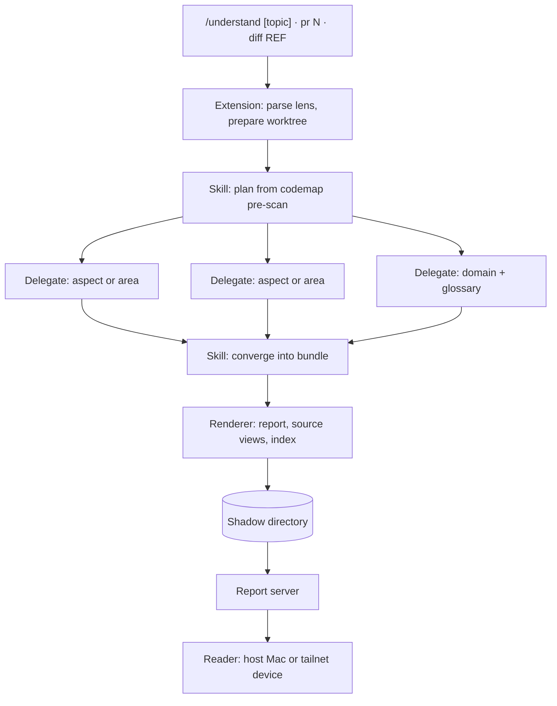
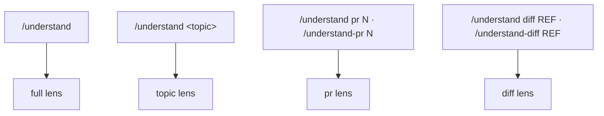
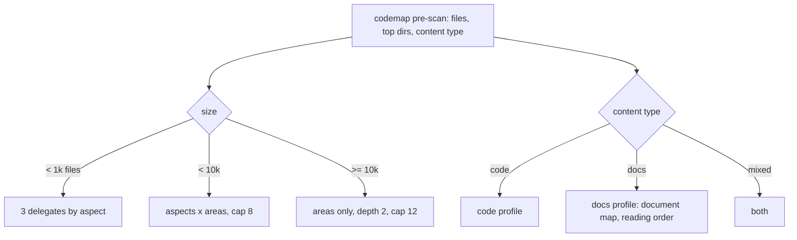
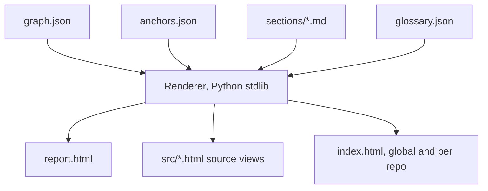
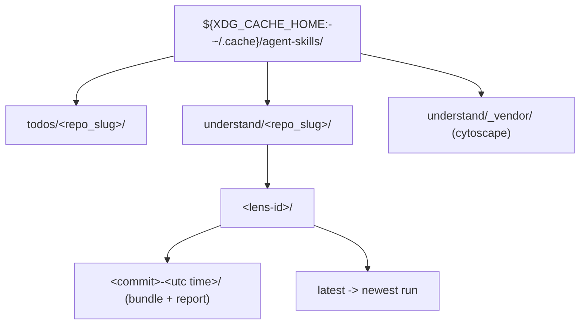
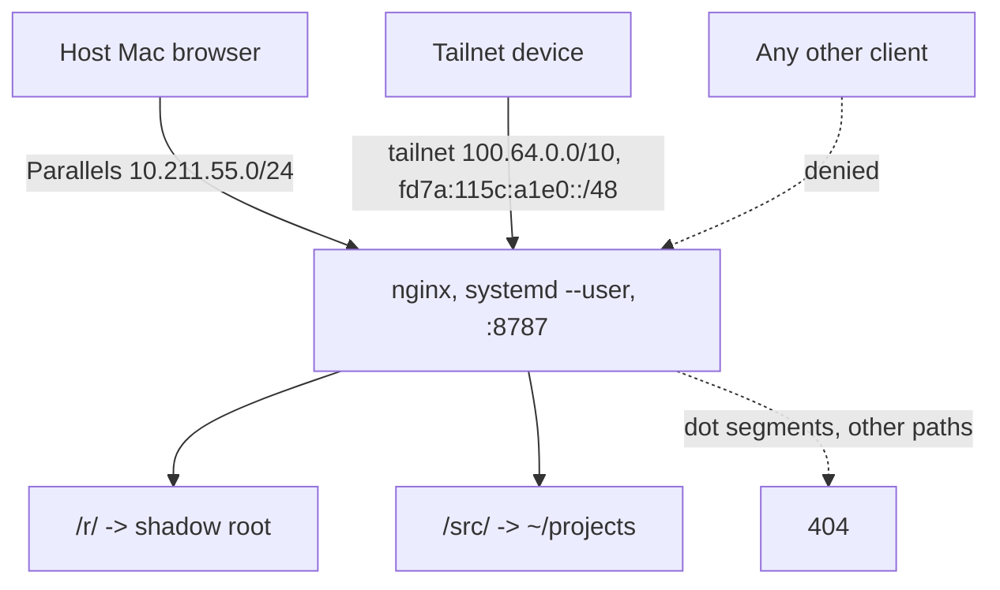

# /understand: handoff spec

> **Status:** Approved in final review (round 6). Ready for build.
> **Owner:** shalomb. **Audience:** implementers (people and agents), reviewers.
> **Scope:** `/understand` command, `understand` skill, renderer, report server.
> **Out of scope:** writing to the repository, hosted or public sharing.

## Who reads what

| Audience | Read, in order |
| :-- | :-- |
| Implementer | At a glance, Spec units 1 to 6, Anti-goals, scenarios |
| Reviewer | At a glance, Anti-goals, ADRs, scenarios |
| Agent that consumes reports | Spec unit 5 (anchors), Glossary |

## At a glance



## Goal and success metric

A user gets a navigable, linked **report** of a repository, a topic, a pull request, or a diff, so that people and agents learn its structure fast.
Success: (1) a fresh agent answers a fixed quiz about a repository better with the report than without; (2) the owner judges the report useful on 3 real repositories.

## Spec units

### 1. Command surface

**Who / When:** the user, in pi inside tmux.



- The command MUST offer completion for `pr` and `diff`.
- `/understand-pr` and `/understand-diff` MUST behave the same as the subcommands.
- The command MUST work in a directory that is not a git repository (full and topic lenses only).
- The pr lens MUST use `gh pr view` metadata and a temporary detached worktree at the PR head, made and removed by the extension.
- The diff lens MUST compare `merge-base(REF, HEAD)` with the working tree, uncommitted changes included.
- The status line MUST show the phase: plan, discover, converge, render. The end message MUST give the URL and a summary of 5 lines or less.

<details><summary>Contract</summary>

```yaml
commands:
  understand: { args: "[topic] | pr <n> | diff <ref>", completion: [pr, diff] }
  understand-pr: { alias_of: "understand pr" }
  understand-diff: { alias_of: "understand diff" }
lenses:
  full: { needs_git: false }
  topic: { needs_git: false }
  pr: { needs_git: true, source: "gh pr view --json title,body,files,baseRefOid,headRefOid", worktree: "<shadow>/wt/pr-<n>", cleanup: always }
  diff: { needs_git: true, base: "merge-base(<ref>, HEAD)", head: working-tree }
progress: { phases: [plan, discover, converge, render], end: { url: required, summary_max_lines: 5 } }
```
</details>

### 2. Discovery plan

**Who / When:** the skill, after a `codemap .` pre-scan.



- Delegates MUST be read-only (`bg_delegate`, inspect capability).
- The planner MUST be a pure function of the pre-scan and the lens, and MUST have unit tests.
- A topic, pr, or diff lens MUST narrow areas to the focus set before it assigns delegates.
- The topic lens MUST expand the topic to terms, find seed nodes, and add 1-hop neighbours.

### 3. Bundle and renderer

**Who / When:** the skill writes the bundle; the renderer runs once per run. See [ADR 0001](../../adr/0001-bundle-and-fixed-renderer.md).



- Agents MUST NOT write HTML.
- The renderer MUST validate the bundle against a versioned schema before it renders.
- The renderer SHOULD pre-render Mermaid to inline SVG with `mmdc` and the system `chromium-headless-shell`. If `mmdc` fails, it MUST fall back to a vendored in-page Mermaid and log the fallback.
- The graph MUST use a vendored Cytoscape.js.
- The report MUST open with no network access.
- The look MUST use Material 3 tokens and an inline SVG subset of Material Symbols, shared with web-presentation.
- Section order MUST end with the glossary.

### 4. Shadow directory and runs



- `repo_slug` MUST be the same as todo-navigator uses.
- Each lens MUST keep the last 5 runs and a `latest` link.

### 5. Anchors and glossary

- Every graph node and section MUST have an HTML id equal to its anchor id.
- Anchor ids MUST be stable across runs: derived from path and symbol, not from order.
- `anchors.json` MUST map each id to `{url, path, line}`.
- Each cited file MUST get a source view with an id `L<n>` on each line.
- The glossary MUST group terms by context: from `GLOSSARY-MAP.md` if present, else inferred from areas. It MUST flag collisions and link each meaning.
- The report MAY offer a `GLOSSARY.md` draft as a patch. It MUST NOT write it to the repository.

### 6. Report server

See [ADR 0002](../../adr/0002-report-server-allow-list.md) and [ADR 0003](../../adr/0003-report-server-tailnet-access.md).



- The server MUST run as the user and MUST NOT need sudo.
- It MUST accept clients from the Parallels network and the tailnet only, and deny all other clients.
- It MUST keep serving the Parallels network when tailscale is down.
- The end message MUST give the report URL for each network.
- It MUST return 404 for any path segment that starts with `.`, and MUST NOT follow symlinks out of a serve root.

## Anti-goals

- No writes to the repository, ever. The only git write is the temporary pr worktree, in the shadow directory.
- No agent-written HTML.
- No network access needed to read a report.
- No exposure of `$HOME` or dotfiles, on any network.
- No changes to the system nginx or the blog site.

## Open decisions

| Id | Question | Owner | Needed before |
| :-- | :-- | :-- | :-- |
| (none) | All nodes settled. | shalomb | build |
| setup | Install `chromium-headless-shell` (sudo apt, once) for Mermaid pre-render. | shalomb | build step 1 |

## Suggested build order (tracer bullets)

1. Renderer plus bundle schema with a hand-written fixture bundle, plus pytest.
2. Report server unit and nginx config, plus a probe test of the 404 and deny rules.
3. Extension with lens parsing and completion, plus bun tests. Skill with the full lens on a small repo.
4. Planner tiers and docs profile.
5. Topic, pr, and diff lenses.
6. Glossary contexts and collisions. Agent quiz for the metric.

## Links

- [Decision tree](../../explanation/understand/decision-tree.md) and [round replies](../../explanation/understand/rounds/)
- [Architecture views](../../explanation/understand/c4.md)
- [Glossary](./GLOSSARY.md)
- [ADR 0001](../../adr/0001-bundle-and-fixed-renderer.md), [ADR 0002](../../adr/0002-report-server-allow-list.md), [ADR 0003](../../adr/0003-report-server-tailnet-access.md)
- [Acceptance scenarios](../../../skills/understand/features/understand.feature)
